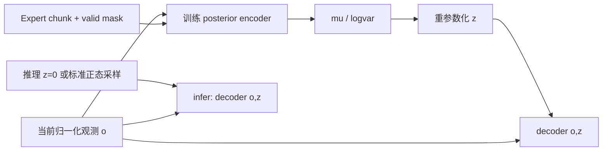

# S20.4 — CVAE latent / KL / prior

[状态唯一来源](../README.md#stage-20--act--temporal-policy) · [代码](../examples/21_act_temporal_policy/cvae_latent.py)
前置：S20.1 mask、S20.2 chunk与S20.3 attention。约0.5～2小时；本课隔离CVAE机制，Transformer decoder留S20.5。

## Problem → Why → Intuition

同一个观测未必唯一决定接下来一段动作：示范者的意图、风格或不可观测因素可能影响chunk。
latent z提供额外条件；训练时encoder从(o,A)估计z的分布，decoder从(o,z)重建A。
运行机器人时没有未来expert A，因此必须绕过这个encoder，只用可用观测与prior latent。

像老师批改时能看答案并总结“解题风格”，考场却不能把答案交给模型推断风格。
KL约束训练时的latent分布靠近可用的prior，使decoder不只适应带答案才能获得的latent。
这不是把未来动作偷偷当推理输入，也不保证latent一定有可解释的风格含义。
当前XY数据没有建立同观测多模式任务；本课不声称验证了模式覆盖。

## Core Concepts / Mathematics

o∈R^6：world XY位置/goal [m]、速度 [m/s]；A∈R^(H×2)：world XY absolute reference [m]。
先复用S19.3 train mean/scale归一化，H10、latent维度d_z=4；z、mu、logvar均无量纲，无world frame。

```text
q_phi(z | o,A,valid) = Normal(mu, diag(exp(logvar)))  # approximate posterior
p(z) = Normal(0,I)                                   # fixed standard-normal prior
sigma = exp(0.5*logvar)                              # logvar是log方差，不是log标准差
z = mu + sigma * epsilon, epsilon ~ Normal(0,I)
prediction = decoder_theta(o,z)
```

重参数化把随机性放到epsilon；固定epsilon时z是mu/logvar的可微函数，reconstruction梯度能够传回encoder。
本课decoder返回点预测，并用masked MSE监督；不另外预测action likelihood variance。

```text
R = mean_valid_action_scalars((prediction - A)^2)
K = mean_batch(0.5 * sum_latent(mu^2 + exp(logvar) - 1 - logvar))
loss = R + beta * K
```

KL方向是KL(q_phi || p)，量纲为nats/sample，先sum latent维再mean batch，不能把它随意改成所有标量mean。
R为归一化动作平方误差，按真实标量平均；两项尺度与维度/归一化约定相关，所以不能直接照搬其他实现的beta。
本课MSE+beta KL是教学加权目标；不声称这种平均/权重恰好等于完整概率模型的精确负ELBO。

**手算：**一维mu=1、variance=4、logvar=ln4、epsilon=.5：sigma=2，z=2，
KL=.5*(1+4−1−ln4)=1.306852819 nats；dz/dmu=1，dz/dlogvar=.5。
mu=0/logvar=0时q=p，KL=0。

## 训练与推理数据路径



`posterior`仅在训练/带标签重建诊断时调用；validation posterior reconstruction也看到答案，不是可部署策略指标。
`infer(observation,z=None)`没有actions/valid参数，默认z=0；传入独立标准正态样本则演示prior sampling。

**z=0是prior的均值，不是从prior随机采样，也不是posterior mu。** 对非线性decoder，decode(o,0)一般不等于E_z[decode(o,z)]。
[ACT作者实现](https://github.com/tonyzhaozh/act/blob/main/detr/models/detr_vae.py)在训练重参数化latent、推理取zero latent；
[论文](https://arxiv.org/abs/2304.13705)为后续完整ACT的算法依据。
作者实现用Transformer与视觉/关节输入；本课posterior输入6维状态、MLP encoder/decoder，重建使用masked MSE，
不是原论文完整结构或损失复现，不沿用其beta数值。

## Math-to-Code / API

`TinyCVAE`是一个显式nn.Module：

- encoder输入concat[o,flatten(masked A),valid]为(B,36)，36→32→8，输出拆成mu/logvar各(B,4)。
- padding先`masked_fill`为normalized0；valid位也传入encoder，真实零标签与缺失标签可以区分。
- decoder输入concat[o,z]为(B,10)，10→32→32→20，reshape成(B,10,2)，共3516参数。
- logvar显式clamp到[-10,10]限制数值极端值；这是本教学实现的数值选择，范围外梯度受clamp影响。

`posterior(o,A,valid)`返回mu/logvar，不修改输入；`decode(o,z)`和`infer(o,z)`返回新预测Tensor。
`reparameterize(mu,logvar,epsilon)`直接表达可微式；训练epsilon由`torch.randn_like`生成，不detach mu/logvar。
`kl_standard_normal`返回可反传标量；`backward()`写参数梯度，Adam.step原地更新weights。
`reconstruction`先选有效动作标量，再求误差；posterior的padding清理与loss mask是两处不同职责。
每个sample至少一个真实标签，否则posterior拒绝；动作窗口本身沿用S20.1 episode边界。

CPU1thread/seed204/batch64/lr.001/100epochs；evaluation noise单独Generator seed2041、固定到每个样本，
以validation的R+beta K选checkpoint，不用prior或rollout挑模型。epoch0也可被选中。
固定epsilon是稳定排序的单样本Monte Carlo代理，不是对posterior期望的精确积分。
prior noise seed2042用于独立诊断；固定随机样本只保证可重复，不代表采样分布覆盖。
保存后weights_only/CPU重载，默认prior预测逐值一致。

## Minimal Experiment / Expected Result

仅依赖requirements已有NumPy与torch==2.14.0+cpu；local helper是sequence_dataset，无MuJoCo/Matplotlib导入、新依赖或安装。

```bash
conda activate mujoco
pwd
echo "$CONDA_DEFAULT_ENV"
which python
python examples/21_act_temporal_policy/cvae_latent.py --prepared tmp/s19_3/verified193
```

prepared是S19.3输出；若本机缺该ignored目录，按[Stage19 README](../examples/20_learning_from_demonstrations/README.md) S19.2→3重建并替换路径。
不需要BC/chunk checkpoint。读train/validation、冻结split/normalizer、不打开test数组。
新ignored tmp/s20_4/run_*：protocol.json先写、cvae.pt、loss.csv、validation_predictions.npz、results.json。
NPZ分别保存posterior mean/sample、prior zero/sample、mu/logvar、epsilon、prior_z、labels/mask与来源映射。

预期beta增大对KL施加更强约束，可能牺牲重建；有限训练中不保证所有指标单调。
未来标签变化可改变posterior；padding变化不能改变posterior；infer必须完全绕过posterior。

## Actual Result / Explanation

2026-10-11 DESKTOP-781D67A，WSL2 Ubuntu24.04.5/kernel6.6.87.2；mujoco环境Python3.12.14，
NumPy2.5.3/Torch2.14.0+cpu metadata、真实模块路径与Adam/distribution API核验；CUDA build None，无安装。
命令为默认加`--output tmp/s20_4/default`；同输入加`--beta 1 --output tmp/s20_4/beta1`，均exit0。

| beta | best epoch | validation KL nats/sample | posterior mean/sample RMSE | prior zero/sample RMSE |
| --- | --- | --- | --- | --- |
| .01 | 80 | .00155199 | .804 / .782 mm | .804 / .779 mm |
| 1 | 80 | .000064119 | .819 / .803 mm | .819 / .802 mm |

sample均为固定noise的一次诊断。两组train1600/validation400窗口；训练loop wall2.072/2.011s，
含epoch评分与selection，不含window构造、checkpoint/诊断存储；不是硬实时/推理成本。

beta1的posterior更接近prior，但本轮prior-zero误差略高；posterior重建不能代替prior误差，二者都不能代替rollout。
本例同观测的expert策略基本确定，decoder可以更多依靠o；小KL与该情境相容。
但尚未系统测decoder对latent的依赖、多个seed或多模式覆盖，所以不能仅凭小KL判定posterior collapse。
KL约束改善分布兼容性，不等于保证prior输出可执行、稳定或恢复成功。

## Validation / Failure Cases / Robotics Context

- 手算z/KL/重参数化梯度通过；独立非平凡Normal KL与torch.distributions交叉核对，KL的mu/logvar解析梯度通过。
- reconstruction梯度通过z传回mu/logvar；无效action位置输入/监督梯度为0。
- padding改NaN时posterior mu/logvar不变；真实labels全部+1使mu max change=.188169/.045115。
- 将posterior替换为抛异常函数，infer zero/sample仍精确一致，证明运行路径不调用encoder。
- 两checkpoint重载、normalizer/split/hash、NPZ source/预测/统计、CSV argmin/目标组合、两组eval/prior noise一致通过。
  重载沿用CPU1thread后预测逐值一致；NumPy/Torch float32 MSE归约交叉核对使用2e−9绝对容差。
- 五CLI非法beta/epochs/已有output/缺input均exit2；Python3.11仅语法检查，实际runtime3.12。

错误：把logvar当log sigma；把sum latent改为mean而不调beta；损失mask正确但encoder读到padding垃圾；
将posterior_mu reconstruction称为推理效果；用future expert chunk在infer推断z；认为z=0等于随机采样；
KL太强导致latent信息减少或太弱导致prior/posterior差距，这些是需诊断的可能风险，不是自动发生的结论。

机器人应用：训练时总结动作chunk中的隐藏因素，部署时用可用观测与固定prior条件生成动作；
后续S20.5才接Transformer decoder与闭环控制。当前不执行机器人动作，也不验证GUI/test/OOD/多模式或完整ACT。

## Interview Capsule / Must Remember

**30秒：**CVAE训练encoder看观测和expert chunk，输出Gaussian posterior；用重参数化让重建梯度通过latent。
KL把posterior拉向标准正态prior。推理没有expert未来动作，绕过encoder用z=0或prior sample，不能报告posterior重建作为策略表现。

**2分钟：**讲(B,H,2)→posterior(B,4)→decoder(B,H,2)与logvar/sigma区别，写出KL(q||N0I)及reduction。
解释mask同时保护encoder输入和重建监督、固定eval noise/validation selection、beta尺度权衡。
z=0为prior mean并非sample或posterior mean；非线性decoder在均值处输出不等于输出期望。
本课MLP机制练习没有Transformer与rollout，尚非ACT。

## My Verification / Run → Modify → Explain

状态见根README，Engineering与Learning分开；本人三项暂未确认。

**Run：**运行默认命令，核对math_probe、KL、四种validation误差及infer isolation结果。

**Modify：**先预测beta .01→1对KL与重建/prior指标的可能影响，再加`--beta 1`运行。
用loss.csv核对R+beta K；说明为何更低KL不保证更低prior RMSE，也不保证闭环更好。

**Explain（五问）：**

1. posterior与prior分别是什么？训练encoder为什么能读A，推理为什么不能？
2. logvar如何变成sigma？重参数化为什么能把reconstruction梯度传回encoder？
3. 写出KL(q||N(0,I))，说明sum latent/mean batch；beta增加有什么权衡？
4. z=0、posterior mu与prior sample有什么区别？decode(o,0)是否等于平均prior输出？
5. padding为何必须同时保护encoder和loss？为什么posterior reconstruction低不能证明prior策略或rollout成功？

本轮止S20.4；S20.5 Tiny state-based ACT / closed-loop等待明确请求。
